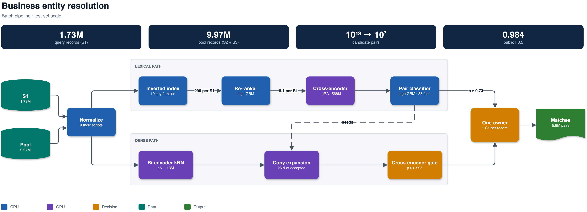
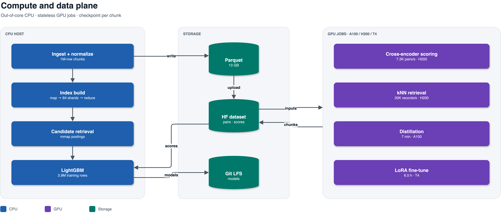
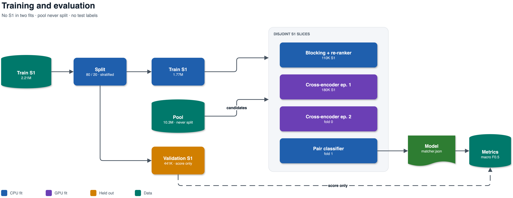

<div align="center">

# Business entity resolution at 10-million-record scale

**Amazon ML Challenge.** Link 1.73M business records to their copies in a 9.97M-record pool, across US, India and France.


</div>



## At a glance

| | |
|---|---|
| **Problem** | Each S1 record has 0 to 11 true copies in the S2 + S3 pool (mean 3.45). A pool record belongs to at most one S1. |
| **Search space** | 1.73M × 9.97M = 1.7 × 10¹³ possible pairs. Blocking and re-ranking cut this to ~10.6M scored pairs (6.1 per S1). |
| **Models** | LightGBM re-ranker (35 features), LightGBM pair classifier (85 features), LoRA cross-encoder on `BAAI/bge-reranker-v2-m3` (568M), `intfloat/multilingual-e5-small` bi-encoder (118M), published and distilled. |
| **Compute** | One CPU host for indexing, features and LightGBM. GPU scoring and retrieval run as stateless Hugging Face Jobs (A100, H200). |
| **Metric** | F0.5 per S1, macro-averaged. Precision-weighted: a false match costs more than a missed one. |
| **Result** | Public leaderboard F0.5 **0.984075**. |

## Architecture

- **Lexical path:** inverted index (290 per S1) → LightGBM re-ranker (6.1 per S1) → LoRA cross-encoder → LightGBM pair classifier, accept at p ≥ 0.73.
- **Dense path:** e5 bi-encoder kNN per country, plus kNN of accepted records → cross-encoder gate at p ≥ 0.995.
- **One-owner:** each pool record goes to the S1 with the highest score.





The diagrams are editable: open any `.drawio.png` or `.drawio` file in [draw.io](https://app.diagrams.net). To
rebuild them, run `python docs/architecture/generate.py docs/architecture`. They were made with the
[drawio-skill](https://github.com/Agents365-ai/drawio-skill) Claude Code skill (MIT), vendored in
`.claude/skills/drawio-skill/`.

## Repository guide

Start here: `AGENTS.md` (rules) → `RESEARCH_LOG.md` (current best, open questions, every run, newest first) →
`submission/Documentation_template.md` (contest write-up) → `submission/code/business_entity_resolution/README.md`
(how to run stages 1–3).

## Glossary

The sections below use the project's internal names. This table defines each one.

**Data and splits**

| Term | Meaning |
|---|---|
| S1 | Query records. Each S1 business has 0 to 11 copies in the pool. |
| S2, S3 | The two other sources. Together they are the **pool**, the records we search. |
| Train S1 / validation S1 | The 80/20 split of the labelled S1: 1,765,458 rows for fitting, 441,363 for scoring only. |
| HOLDOUT_TEST | The code name for validation S1. |
| MATCH_ALL | The 1,655,458 train S1 used for the cross-encoder and the stage-3 classifier. The rest of train S1 tuned stages 1 and 2. |
| MATCH_TRAIN | 180,000 S1 from MATCH_ALL. The experiment set: every classifier change is compared on it with 5-fold GroupKFold by S1. |
| MATCH_VALID | 20,000 S1. A small check set, scored only when a change is adopted. |
| DEV_REST_180K | 180,000 S1 from MATCH_ALL. The cross-encoder trained on them for its first epoch. |
| DEV_REST_REST | The rest of MATCH_ALL, in two folds. Fold 0 trained the cross-encoder's second epoch. Fold 1 trained the stage-3 classifier. |
| OOF | Out-of-fold: a score for each row from a model that did not train on that row. |

**Submissions and experiments**

| Term | Meaning |
|---|---|
| S*N* (S1 … S18) | Submission number *N*. Files are in `submission/output_v<N>/`. Here S1 can also mean source 1; the context tells which. |
| LB | The public leaderboard score of an uploaded submission. |
| M###, N##, TH1, D10, SD5 | Experiment IDs. Each has an entry in `RESEARCH_LOG.md` or `exps/M###.json`. |
| `run_s<N>.sh` | The shell script in `plan/checks/` that builds submission *N* from the previous one. |

**Models and runs**

| Term | Meaning |
|---|---|
| Stage 1 | Inverted-index blocking: hashed name and address keys plus a logistic model. About 290 candidates per S1. |
| Stage 2 | LightGBM re-ranker. It cuts the list to about 6.1 candidates per S1. |
| Stage 3, matcher | The LightGBM pair classifier that makes the lexical accept decision. |
| `ce_rec` | Cross-encoder after epoch 1: a LoRA adapter on `BAAI/bge-reranker-v2-m3`. |
| `c0`, `ce_rec_c0` | Cross-encoder after epoch 2. This is the live cross-encoder. |
| `p_ce`, `ce_p` | The cross-encoder probability for a pair. It is one feature of the stage-3 classifier. |
| `full_single` | Stage-3 classifier trained once on all of MATCH_ALL, without cross-encoder features (S2). |
| `full_ce` | Stage-3 classifier with the `ce_rec` probability as a feature (S6). |
| `full_c0` | Stage-3 classifier with the `c0` probability as a feature (S9). |
| `full_c0_rgrp` | `full_c0` plus the reverse-name (`r`) and group-profile (`grp`) features. The live classifier. |
| `_t073` | Suffix for a run with decision threshold 0.73. |
| `e5_distil` | `intfloat/multilingual-e5-small` fine-tuned to copy the `c0` cross-encoder's scores. |
| Seed matcher | An earlier classifier whose accepted pairs start copy expansion. It does not make final decisions. |

**Decision rules and retrieval**

| Term | Meaning |
|---|---|
| One-owner | A pool record goes only to the S1 that scores it highest. True links obey this rule. |
| DRACE | Dense Retrieval And Copy Expansion. The second search after the classifier: bi-encoder nearest neighbours of each S1, plus neighbours of each accepted pool record. `c0` admits a new pair at p ≥ 0.995. |
| DRACD, DRACD5 | DRACE pair files from the distilled bi-encoder (`e5_distil`). DRACD holds each S1's top 2 neighbours; DRACD5 adds ranks 3 to 5. |
| Copy expansion | One business has about 3.45 pool copies. After one copy is accepted, its nearest neighbours are often the others. |

**Feature groups (stage 3)**

| Prefix | Meaning |
|---|---|
| `rv_*` (rev) | Reverse-name ownership: search from the pool name back to the S1 names, used when the pool address is empty. |
| `nf_*` (nfreq) | Whole-name frequency: how often the name appears in S1 and in the pool. A common name is weaker evidence. |
| `g_*` (grp) | Group profile: how the candidate compares with the S1's other accepted pool records. |

## Current best: submission 18, public LB 0.984075

File: `submission/output_v18/matching_results.tsv` + `candidate_pairs.tsv` (sha1 of matching_results `7334635c…`;
local only, not in git). Metrics: `artifacts/metrics/drace_test_s18.json`. Upload log: `reports/test_usage_log.md`.

Pipeline, in order:

1. **Normalization.** Unicode NFC, romanisation of 9 Indic scripts, accent and case folding, per-country
   abbreviation map mined from the unlabelled pool, transliteration dictionary learned from train pairs.
2. **Stage 1: lexical blocking.** Inverted index over 10 hashed key families (whole name, name tokens, name
   character 3-grams, token pairs, Metaphone, consonant skeleton, address tokens/bigrams, name skeleton × rare
   address token), document-frequency caps, then a logistic model over per-family scores with per-channel quotas.
3. **Stage 2: LightGBM re-ranker + cut.** Keeps rank ≤ 5 or p ≥ 0.05 up to rank 60 (~6.1 candidates per test S1).
4. **Stage 3: LightGBM pair matcher** `full_c0_rgrp` (`work/match/models/`). 85 features: 68 string/number/list
   features, `ce_p` from the cross-encoder c0, reverse-name ownership (`rv_*`, 7), whole-name frequency (`nf_*`, 3),
   group profile against the S1's other accepted records (`g_*`, 6). One model trained on MATCH_ALL minus
   DEV_REST_180K (DEV_REST_REST fold 1 only), 3,864,095 fit rows, best_iteration 1190 of 12000 (not truncated).
   Decision: isotonic-calibrated p ≥ 0.73, then one-owner (a pool record goes only to the S1 that scores it highest).
   The fitted threshold was 0.70; S16 raised it to 0.73, which is flat on train (TH1, `thr_sweep_s14.json`).
5. **DRACE (Dense Retrieval And Copy Expansion), after the matcher.** New pairs come from three nearest-neighbour
   queries by exact cosine search within each country, excluding pairs already in the candidate list and pool
   records the matcher already assigned:
   - untrained `intfloat/multilingual-e5-small`: each S1's top 5;
   - copy expansion: top 5 neighbours of every pool record the full_c0 matcher (S9) accepted;
   - `e5_distil` (e5-small fine-tuned to reproduce c0's margins, InfoNCE + MarginMSE): each S1's top 10.
   Cross-encoder c0 scores every new pair (6,933,749 on test); pairs with p ≥ 0.995 are added under one-owner.
   S18: 5,728,253 matcher pairs + 84,402 DRACE pairs = 5,812,655; candidate file 10.13 pairs per S1.

**Cross-encoder c0** (`ce_rec_c0`): LoRA adapter on `BAAI/bge-reranker-v2-m3` (568M params). Trained 1 epoch on
DEV_REST_180K (`ce_rec`), then continued 1 epoch on DEV_REST_REST fold 0 (3,285,477 pairs). Scoring and retrieval run as Hugging Face Jobs (A100 / H200,
`ce/hf_job/`); LightGBM runs locally.

## Leaderboard history

Public LB scores come from the leaderboard page, logged in `reports/test_usage_log.md`. S4, S5, S8, S9 and S15
were built but not uploaded. Every file is in `submission/output_v<N>/` (local); only S1 (`submission/output/`) and
S6 (`submission/output_v6/`) are in git (LFS).

| Sub | Change over the previous upload | Public LB |
|---|---|---|
| S1 | 3-stage pipeline, 50-feature matcher | 0.966109 |
| S2 | matcher trained on MATCH_ALL (full_single) | 0.966797 |
| S3 | contention-feature hybrid | 0.966 (rounded) |
| S6 | + cross-encoder `ce_rec` p_ce as a LightGBM feature | 0.976128 |
| S7 | + whole-name frequency (nfreq) | 0.976205 |
| S10 | c0 cross-encoder in the matcher (S9) + DRACE: e5 S1 top 5, copy expansion top 2 | 0.98135 |
| S11 | + reverse-name ownership | 0.981623 |
| S12 | + group profile, distilled-e5 S1 top 2 | 0.983064 |
| S13 | distilled-e5 S1 top 5 | 0.983604 |
| S14 | copy expansion top 5 | 0.983741 |
| S16 | matcher threshold 0.70 → 0.73 | 0.983958 |
| S17 | distilled-e5 S1 top 7 | 0.984028 |
| S18 | distilled-e5 S1 top 10 | **0.984075** |

## Models: where each one lives

| Model | Path | In git |
|---|---|---|
| Stage-1 logistic blocking model | `work/stage1/model_v1.json` | yes |
| Stage-2 LightGBM re-ranker + cut | `work/rerank/model_v1.txt`, `model_v1_meta.json`, `cut_v1.json` | yes (LFS) |
| **Live stage-3 matcher** (S16–S18), full_c0_rgrp, threshold 0.73 | `work/match/models/` | yes (LFS) |
| S6 matcher (full_ce) | `work/match/runs/full_ce/models/` | yes (LFS) |
| Submission-1 matcher, 50 features (loads only with code at `fd77ee7`) | `work/match_k5_submission1/models/` | yes (LFS) |
| Cross-encoder `ce_rec` (parent of c0) | `cross_encoder_lora/adapter/` | yes |
| Cross-encoder c0 | `work/ce/ce_rec_c0/adapter/`; private HF dataset `prathameshk421/ber-ce-scoring`, `adapter_c0/` | no |
| Distilled retriever `e5_distil` | private HF dataset `prathameshk421/ber-ce-scoring`, `e5_distil/` | no |
| Every other experiment run | `work/match/runs/<run>/models/` | no |

Licenses and parameter counts for every model and library: `reports/licenses.md`.

## Rebuilding the current best

1. Stages 1–3 base pipeline: package README (`submission/code/business_entity_resolution/README.md`).
2. Live matcher: `work/match/models/` is byte-identical to `work/match/runs/full_c0_rgrp_t073/models/`, which
   `run_s16.sh` creates from `full_c0_rgrp` (trained by `plan/checks/run_s12_mac.sh`). Test prediction
   (`python -m ber.cli exp-predict --run full_c0_rgrp_t073`) needs the test c0 scores and the `rev`, `nfreq`,
   `grp_full` test feature groups, none of which are in git; RESEARCH_LOG entries S11-file and S12-file name the
   commands that built them.
3. DRACE: `plan/checks/run_s16.sh` → `run_s17.sh` → `run_s18.sh`. They need the `hf` CLI logged in with access
   to the private dataset and the S13 test inputs (`work/ce/pairs_{DRACE,DRACD,DRACD5}_TEST.parquet`, their c0
   scores, the retrieval top-k files). `run_s17.sh` and `run_s18.sh` wait on hard-coded HF job IDs for the
   distilled-e5 retrieval, so a fresh rebuild must relaunch that job (`ce/hf_job/retrieve_job.py`,
   `RETR_MODEL_DIR=e5_distil`) first.
4. Each chain ends with the official validator (`--check-ids`) and prints the sha1 of `matching_results.tsv`.

## Layout

```
AGENTS.md, PROGRESS.md, RESEARCH_LOG.md   rules, phase log, experiment log
submission/
  code/business_entity_resolution/        package `ber`: stages 1-3, experiment runner (configs/, tests/, run_matcher.sh)
  output/, output_v<N>/                   submission files per upload (only output/ and output_v6/ in git)
  Documentation_template.md               contest write-up
ce/                                       cross-encoder training/scoring (train.py, train_continue.py, ce_submit.py)
  hf_job/                                 Hugging Face Jobs: score_job, retrieve_job, distill_job, iter_job, collect
cross_encoder_lora/adapter/               ce_rec LoRA adapter
exps/M###.json                            matcher experiment specs (plan/EXPERIMENT_ROUTINE.md)
plan/                                     design docs, ROUND_CAP_EVIDENCE.md, VALIDATION_PLAN.md
  checks/                                 one-off analysis scripts and the run_s*.sh submission chains
artifacts/metrics/*.json                  every reported number is written here by a script
work/                                     pipeline intermediates (git-ignored) except the models listed above
reports/                                  EDA, blocking, diagnostics, licenses, test_usage_log.md
cloud/, scripts/                          GPU instance setup (EC2) and helper scripts
notes/                                    problem statement and early notes
data/write_s1_split.py                    rebuilds the train/validation S1 split (TSVs not in git)
docs/split.md                             pointer to the split write-up
legacy/src/, archive/agent_runs/          superseded phase 0-3 scripts; retired overnight-agent tooling
```

## Not in git

Contest TSVs (`student_resource/`, `data/student_resource/`), everything under `work/` except the models above
(~13 GB of indexes, normalized stores, features, candidates, cross-encoder scores), submission files other than
S1 and S6, `logs/`, legacy `artifacts/*.parquet|*.pkl`, and zip bundles (`*.zip`, `*.z01`).

Git LFS is required for the models and the S1/S6 outputs: `git lfs install && git lfs pull`.

## Out of date

- The package README describes the submission-1 matcher (50 features, no cross-encoder, no DRACE).
- `submission/Documentation_template.md` stops at S13 (LB 0.98360).

## Next

- Score the stage-3 headline on validation S1 for the S18 pipeline (`match-eval --set HOLDOUT_TEST`); it has not
  been run for any matcher after submission 1.
- France recall: in the S17 test predictions, France S1 get 3.243 predicted pairs vs India 3.365 / US 3.385, with
  candidate lists of 9.05 vs 5.63 / 5.59 (`logs/country_shift_s17.log`; train truth is ~3.46 per S1). No France
  labels exist; a train-side proxy such as leave-one-country-out (N08) is the only way to measure it.
