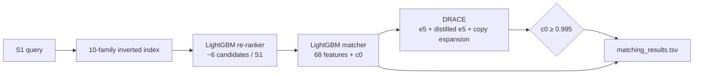

# VadaPav — Business Entity Resolution

**Amazon ML Challenge 2026.** Link every Source-1 business to its copies in the S2 + S3 pool.

**Team:** Prathamesh Kinagi, Ajinkya Jagdish Pathak, Aayush Kulkarni, Aarush Oak — Pune Institute of Computer Technology.

| | |
|---|---|
| **Public leaderboard** | **0.9836** — submission 13 |
| **Held-out train F0.5** | **0.9880** — 180k MATCH_TRAIN, M027 + DRACE |
| **First time we cleared 0.984** | **0.98438** — cross-encoder epoch 1, same 180k slice |
| **Metric** | macro per-S1 **F0.5** (false positives cost more than false negatives) |

Submission 1 scored **0.9661**. The cross-encoder, then dense retrieval, then a retriever distilled from that cross-encoder, is the rest of the climb.

```
0.9661 ── S1   lexical blocking + LightGBM
0.9761 ── S6   + LoRA bge-reranker-v2-m3          ← crossed 0.984 on held-out train
0.9814 ── S10  + second epoch (c0) + DRACE
0.9831 ── S12  + ownership features + distilled e5 (S1 top-2)
0.9836 ── S13  distilled e5 widened to S1 top-5     ← submitted
```

Numbers are public-leaderboard scores from `reports/test_usage_log.md`. Held-out train numbers are in `submission/Documentation_template.md` and `artifacts/metrics/`.

---

## What actually runs

Four stages. Country is an open set (train is US and India; test also has France). Nothing is one-hot on country, and S2/S3 are never subset: every query searches the full pool.



1. **Blocking.** Ten inverted-index families (exact name, name tokens, name+postal, address tokens, abbreviations, transliteration keys, …). A logistic model mixes family scores. A **LightGBM** re-ranker on cheap string features cuts the list to about **6.1 candidates per S1**. On the 441,363 validation S1 that list still holds entity recall **0.9984** and a ceiling F0.5 of **0.9928**.
2. **Pair matcher.** **LightGBM** binary logloss on 68 hand features (token-set / token-sort / Jaro-Winkler / IDF Jaccard / phonetic / address-number agreement / list position) plus one learned score, `p_ce`. Isotonic calibration, then a threshold and **one-owner**: a pool row is kept only for the S1 where it scores highest. Shipped run `full_c0_rgrp` uses threshold **0.7** (`artifacts/metrics/match_train_full_c0_rgrp.json`).
3. **Ownership features** for pool rows that have a name and no address — 77% of the true pairs the matcher still drops. Reverse-name retrieval asks where this S1 ranks among *all* S1 names nearest that pool name. A group profile compares the candidate with pool rows already accepted for the same S1.
4. **DRACE** (dense retrieval and copy expansion), after the matcher. It finds copies that share no blocking key, and the cross-encoder is the only judge of those new pairs.

Contest write-up: `submission/Documentation_template.md`. Experiment log: `RESEARCH_LOG.md`.

---

## The cross-encoder we fine-tuned

**Teacher:** [`BAAI/bge-reranker-v2-m3`](https://huggingface.co/BAAI/bge-reranker-v2-m3) (568M) with **LoRA**.

| | |
|---|---|
| Adapter | r = 16, α = 32, dropout 0.05, on Q/K/V + the classifier head |
| Trainable | **3.4M** of 571M (0.6%) |
| Loss | `BCEWithLogitsLoss` on one logit; inference is `sigmoid` → `p_ce` |
| Text | `name \| address` on each side, 128 tokens |
| Epoch 1 | 971,466 pairs, slice `DEV_REST_180K` — disjoint from the S1 used to score the matcher |
| Epoch 2 (`ce_rec_c0`) | 3.29M more pairs, hash-fold 0 of `DEV_REST_REST`, lr 5e-5, batch 32, one T4, 6.5 h |
| Held-out | MATCH_VALID AUC **0.99896**, logloss **0.0402** |

`p_ce` enters LightGBM as a single column. Rank, margin, list z-score, and softmax share moved F0.5 by at most ±0.00008 (`cefe_ablation.json`), so they stayed out.

That one feature is the jump. Held-out train F0.5 went from **0.97807** (68 string features) to **0.98438** (epoch 1). Public leaderboard went from **0.9668** to **0.9761**. Epoch 2 (`c0`) added another **+0.00106** F0.5 on the 180k slice, 95% CI [0.00091, 0.00121].

Code: `ce/train.py`, `ce/train_continue.py`. Shipped epoch-1 adapter: `cross_encoder_lora/adapter/`. Scoring checkpoint used downstream: `ce_rec_c0`.

---

## Distilling that reranker into the embedding model

The lexical index misses **2.43%** of true pairs (15,117 of 621,534 on 180k S1 vs the 10.3M train pool). Those misses share no blocking key. A bi-encoder can still find them. Off-the-shelf `intfloat/multilingual-e5-small` (118M) was not trained on our name/address noise, so we distilled **c0 into e5**.

**Student:** full fine-tune of `multilingual-e5-small`. Not LoRA. Mean pool, L2 norm, text `query: {name} | {address}`, max length 64. Same pooling the retriever uses at inference.

**Triplets** (`plan/checks/distill_e5.py`), 150k S1 from `DEV_REST_REST` **fold 1** only. Fold 1 is disjoint from MATCH_TRAIN (the gate set) and c0 never trained on it, so every teacher score is out of sample.

- **Positive:** a true pool row. If it was in the candidate list, teacher `p` is c0. If blocking missed it, teacher `p` is 0.999.
- **Hard negative:** the two *false* in-list candidates with the **highest** c0 probability — the pairs the reranker itself found hardest.
- **435,454** triplets. One epoch. 6.8 minutes on one A100.

**Loss** — InfoNCE plus MarginMSE (Hofstätter et al.), λ = 1, temperature 0.05:

```
InfoNCE:   q · [pos ; neg] / 0.05     cross-entropy, label = the positive
MarginMSE: cos(q, pos) − cos(q, neg)  ← MSE →  p_c0(pos) − p_c0(neg)
```

The student does not copy the teacher’s probability. It copies the **margin**: how much more the reranker believes the true copy than the hard false one. That margin is what retrieval needs, because DRACE ranks by cosine.

```python
# plan/checks/distill_e5.py
eq, ep, en = enc([q[i] for i in idx]), enc([p[i] for i in idx]), enc([n[i] for i in idx])
cand = torch.cat([ep, en])
logits = eq @ cand.T / 0.05
lab = torch.arange(len(idx), device=dev)
nce = torch.nn.functional.cross_entropy(logits, lab)
margin_s = (eq * ep).sum(1) - (eq * en).sum(1)
margin_t = torch.from_numpy(tp[idx] - tn[idx]).to(dev)
mse = torch.nn.functional.mse_loss(margin_s, margin_t)
loss = nce + a.lam * mse
```

### What the distilled embedder recovered

Blocking misses, S1 query only, top-5, 180k MATCH_TRAIN (`gate1_gate1.json`, `gate1_gate1_distil.json`):

| Retriever | Missed-pair recall @5 | India |
|---|---|---|
| `multilingual-e5-small`, frozen | 21.7% | **24.4%** |
| same model, distilled from c0 | **35.5%** | **47.7%** |

India almost doubled. The frozen model had never seen Devanagari-to-Latin noise or our legal-suffix variants; the teacher had, and the margin loss moved that into the embedding.

DRACE then **filters** those neighbors. A new pair is kept only if `c0 ≥ 0.995` and one-owner still holds. Added pairs at that cut are **97.9%** correct. Untrained e5 inside DRACE is worth **+0.00251** F0.5 on the 180k slice, CI [0.00239, 0.00264]. The distilled S1 channel on top:

| Channel | Δ F0.5 vs DRACE with frozen e5 | Where |
|---|---|---|
| Distilled S1 top-2 | **+0.00049** [0.00040, 0.00058]; India **+0.00120** | `gate2_union.json` variant B — submission 12 |
| Distilled S1 top-5 | **+0.00075** [0.00065, 0.00085] | variant C — **submission 13** |

Public leaderboard moved with it: **0.9816 → 0.9831 → 0.9836**.

Inference is exact cosine, per country: `Q @ P_countryᵀ` and top-k (`ce/hf_job/retrieve_job.py`). FAISS HNSW / IVFPQ exists for scale checks; the submitted DRACE path does not use it. The distilled weights are the `e5_distil` checkpoint (`work/retrieval/e5_distil/`, also on the private dataset `prathameshk421/ber-ce-scoring`).

Reverse-name features still use the **frozen** e5. Only the DRACE S1 query uses `e5_distil`.

---

## Score ladder

Macro F0.5 over S1, singletons included. A singleton with an empty prediction scores 1.0. A missing prediction is an empty prediction.

| Submission | What changed | Held-out train F0.5 | Public LB |
|---|---|---|---|
| S1 | 3 stages, 50 features | 0.97412 (180k OOF) | 0.96611 |
| S2 | 68 string features | 0.97807 | 0.96680 |
| **S6** | **+ cross-encoder, epoch 1** | **0.98438** | **0.97613** |
| S7 | + name frequency | — | 0.97621 |
| **S10** | c0 (epoch 2) + DRACE | **0.98802** (M027 + DRACE, 180k) | **0.98135** |
| S11 | + reverse name + name frequency | +0.00037 on the S10 matcher | 0.98162 |
| S12 | + group profile + distilled e5, S1 top-2 | 0.98643 (matcher, 83,523-S1 calibration slice) | 0.98306 |
| **S13** | distilled e5 widened to S1 top-5 | +0.00026 over S12 on train | **0.98360** |

Paired gains on 180k MATCH_TRAIN, 95% CI (`artifacts/metrics/`):

| Step | Δ F0.5 |
|---|---|
| Cross-encoder epoch 2 instead of epoch 1 | +0.00106 [0.00091, 0.00121] |
| DRACE, frozen e5 | +0.00251 [0.00239, 0.00264] |
| Reverse-name retrieval | +0.00028 [0.00016, 0.00039] |
| Group profile | +0.00016 [0.00005, 0.00027] |
| Distilled S1 query, top-2 | +0.00049 [0.00040, 0.00058] |

The **0.98643** figure is the final matcher on its calibration slice (`holdout_f05` in `match_train_full_c0_rgrp.json`), not the 441k validation S1 file and not the public board. The **0.98802** figure is M027 + DRACE on 180k MATCH_TRAIN, before the S12/S13 ownership and distillation deltas, which were measured as paired gains on that same slice rather than re-reported as one new headline.

Leaderboard uploads were logged and not used to pick thresholds (`reports/test_usage_log.md`).

---

## Split

Train S1 is cut 80/20, seed 42, strata country × singleton (`data/student_resource/dataset/split.md`).

| Slice | S1 rows | Labels |
|---|---|---|
| `train_source1_train.tsv` | 1,765,458 | OK for thresholds, negatives, training |
| `train_source1_validation.tsv` | 441,363 | scoring only |
| S2 + S3 | full files | never subset |

The cross-encoder trains on `DEV_REST_*` slices whose S1 do not overlap MATCH_TRAIN. Distillation trains on fold 1; c0 trains on fold 0. MATCH_TRAIN is where the gates are scored.

---

## Reproduce

Lexical pipeline (no GPU):

```bash
python -m venv .venv
.venv/bin/pip install -r submission/code/business_entity_resolution/requirements.txt
export PYTHONPATH=submission/code/business_entity_resolution/src
python -m ber.cli --help
```

Stage-by-stage commands, times, and the `work/` layout: `submission/code/business_entity_resolution/README.md`.

Cross-encoder, distillation, DRACE:

```bash
export PYTHONPATH=submission/code/business_entity_resolution/src:ce

# LoRA on bge-reranker-v2-m3, then continue to c0 on fold 0
.venv/bin/python ce/train.py --pairs work/ce --model BAAI/bge-reranker-v2-m3 --out work/ce/ce_rec --mode lora
.venv/bin/python ce/train_continue.py --pairs work/ce --base BAAI/bge-reranker-v2-m3 \
  --init-adapter cross_encoder_lora/adapter --fold 0 --out work/ce/ce_rec_c0

# Triplets, then distill (local) or ce/hf_job/distill_job.py (A100)
.venv/bin/python plan/checks/distill_e5.py --dump
.venv/bin/python plan/checks/distill_e5.py --n-s1 150000

# Submitted chains
bash plan/checks/run_s13.sh    # distilled e5 S1@5 + c0 ≥ 0.995 merged onto full_c0_rgrp
```

Models are MIT or Apache-2.0 and under 8B parameters. Training and inference code does not call a hosted LLM, geocoder, or gazetteer. Library list: `reports/licenses.md`.

Git LFS is required for the LightGBM models and output TSVs: `git lfs install && git lfs pull`.

---

## Layout

```
README.md                  this file
AGENTS.md                  split rules, metric, what not to do
RESEARCH_LOG.md            every run, including S12–S13
submission/
  Documentation_template.md    contest write-up (the long version of this page)
  code/business_entity_resolution/   package `ber`: blocking, re-ranker, matcher
  output*/                   submitted matching_results.tsv
ce/                        cross-encoder train / score, HF jobs, retrieve_job.py
plan/checks/               distill_e5.py, gate1/gate2, drace_test.py, run_s13.sh
cross_encoder_lora/adapter/   epoch-1 LoRA
artifacts/metrics/         every number on this page was written by a script
reports/                   licenses, leaderboard log, EDA
work/                      intermediates (git-ignored), including e5_distil/
```

`student_resource/` and the contest TSVs are not in git. Rebuild the S1 split with `data/write_s1_split.py`.
